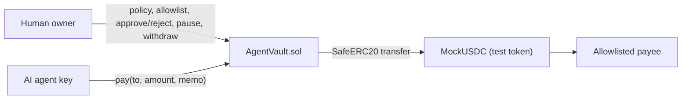

# AgentVault

**An on-chain spending-policy wallet for AI agents.** A human owner funds a vault and gives an AI agent an
address with a policy. The smart contract - not the agent's prompt - rejects anything outside the policy, and
large payments wait for the human to approve them.

> B.Tech CSE course project ("Smart Contract and Development"). Testnet only. **Not audited, not
> production-ready.** See [docs/SECURITY.md](docs/SECURITY.md).

## Why

AI agents are starting to make payments on their own (for example over the x402 HTTP payment protocol).
If an agent's only guard-rail is its prompt, a prompt injection or a leaked key can empty the wallet.
AgentVault moves the limits on-chain:

| Rule | Enforced by |
|---|---|
| Max per payment (`perTxLimit`) | `pay()` reverts `ExceedsPerTxLimit` |
| Max per fixed 24h window (`dailyLimit`) | `pay()` / `approveRequest()` revert `ExceedsDailyLimit` |
| Only allowlisted payees | `PayeeNotAllowed` |
| Agent expiry / revocation | `AgentExpired` / `AgentNotActive` |
| Payments above `approvalThreshold` need the owner | stored as **Pending**, executed by `approveRequest()` after re-checking the policy |
| Emergency stop | `pause()` blocks agent payments and approvals |

## Architecture



Details, pay() flowchart, design decisions and threat model: [docs/ARCHITECTURE.md](docs/ARCHITECTURE.md).

## Repo layout

```
contracts/AgentVault.sol        the vault
contracts/MockUSDC.sol          6-decimal test ERC-20 (NO VALUE)
contracts/test/ReentrantToken.sol  test-only malicious token
test/AgentVault.test.js         53 tests incl. property-style fuzz
scripts/deploy.js               deploy to hardhat / sepolia
scripts/demo.js                 end-to-end agent demo
flat/                           flattened sources for Remix + Etherscan (npm run flatten)
docs/                           ARCHITECTURE, SECURITY, DEPLOY_REMIX
report/                         course report + generator + real outputs
```

## Setup

Requirements: Node.js 20+ (tested on 20.20.2), npm.

```bash
npm install
npx hardhat compile
```

Pinned stack: Solidity 0.8.28 (optimizer 200 runs, EVM cancun), Hardhat 2.29.1,
@nomicfoundation/hardhat-toolbox 6.1.2 (ethers v6), OpenZeppelin Contracts 5.4.0.

## Test

```bash
npx hardhat test       # 53 passing
npx hardhat coverage   # AgentVault.sol: 100% stmts / 96.81% branches / 100% funcs / 100% lines
```

## Demo (local)

```bash
npx hardhat run scripts/demo.js
```

The agent makes four attempts: (1) small payment -> executed, (2) non-allowlisted payee -> `PayeeNotAllowed`,
(3) over per-tx limit -> `ExceedsPerTxLimit`, (4) over threshold -> Pending -> owner approves -> executed.
Real output: [report/demo_output_local.txt](report/demo_output_local.txt).

## Deploy to Sepolia

**Option 1 - Remix + MetaMask (no key on disk):** follow [docs/DEPLOY_REMIX.md](docs/DEPLOY_REMIX.md).

**Option 2 - script:** copy `.env.example` to `.env` (git-ignored) and fill in a **test-only** account:

```bash
cp .env.example .env    # set SEPOLIA_RPC_URL, DEPLOYER_PRIVATE_KEY, optional ETHERSCAN_API_KEY
npx hardhat run scripts/deploy.js --network sepolia
```

**Demo on Sepolia** needs a second throwaway account as the agent (`AGENT_PRIVATE_KEY`, a little Sepolia ETH
for gas). Set `TOKEN_ADDRESS` / `VAULT_ADDRESS` to attach to an existing deployment, then:

```bash
npx hardhat run scripts/demo.js --network sepolia
```

## Sepolia deployment

_Pending - to be filled in after deployment._

## Course report

`report/AgentVault_Report.docx` (+ PDF) is generated from the real test, coverage, Slither, gas and demo
outputs in `report/`:

```bash
node report/diagrams/render.js                              # figures (SVG -> PNG via headless Chrome/Edge)
python report/generate_report.py                            # builds the .docx (needs python-docx)
powershell -ExecutionPolicy Bypass -File report/finalize_word.ps1   # Windows + Word: update index, export PDF
```

Screenshots still to add are listed in `report/SCREENSHOTS_TODO.md`.

## Security

Summary: CEI ordering, `nonReentrant` on every token-moving function, SafeERC20, custom errors, input
validation, policy re-check on approval, `renounceOwnership` disabled. Known limitations include a single-EOA
owner, fixed (not rolling) window, and unbounded pending requests. Full list and what still needs review:
[docs/SECURITY.md](docs/SECURITY.md).

## License

[MIT](LICENSE)
