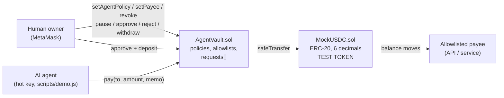
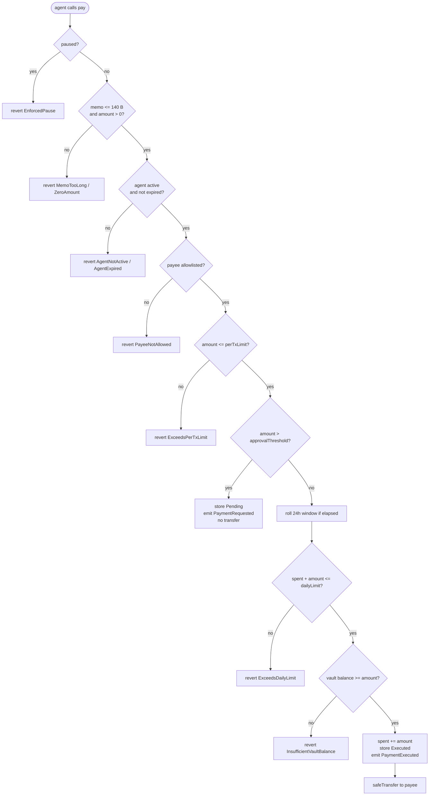
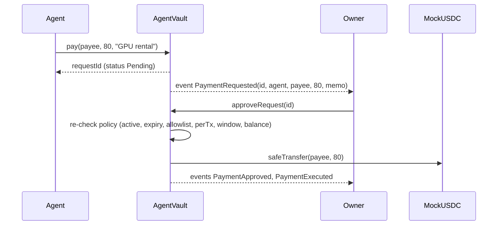

# AgentVault - Architecture

AgentVault is a single-token vault in which a human **owner** gives an AI **agent** a spending policy.
The policy is enforced by the contract, not by the agent's prompt or off-chain code: if the agent (or
whoever steals its key) asks for something outside the policy, the transaction reverts.

## 1. Components



| Component | Role |
|---|---|
| `AgentVault.sol` | Holds the tokens; stores one `AgentPolicy` per agent, a payee allowlist per agent, and every payment in `requests[]`. Inherits OpenZeppelin `Ownable`, `Pausable`, `ReentrancyGuard`; uses `SafeERC20`. |
| `MockUSDC.sol` | 6-decimal ERC-20 with owner-only `mint`. Stand-in for a stablecoin on testnet. **No value.** |
| `scripts/deploy.js` | Deploys both contracts, writes `deployments/<network>.json`, optional Etherscan verify. Refuses any chain other than Hardhat (31337) or Sepolia (11155111). |
| `scripts/demo.js` | Owner funds + configures; agent makes 4 payment attempts showing each policy rule. |
| `test/AgentVault.test.js` | 53 unit/property tests (see docs/SECURITY.md and report). |

## 2. Data structures

```solidity
struct AgentPolicy {
    bool    active;
    uint128 perTxLimit;        // max per single payment
    uint128 dailyLimit;        // max total executed per fixed 24h window
    uint128 approvalThreshold; // amount > threshold => owner approval needed
    uint64  expiry;            // agent can't spend when block.timestamp > expiry
    uint128 spentInWindow;
    uint64  windowStart;
}
enum Status { Pending, Executed, Rejected }
struct PaymentRequest { address agent; address to; uint128 amount; Status status; uint64 createdAt; string memo; }
```

Every call to `pay()` that does not revert creates one `PaymentRequest`, so the array is a complete on-chain
audit log of what the agent spent or asked to spend.

## 3. Policy rules

`setAgentPolicy` requires `agent != 0`, `0 < perTxLimit`, `approvalThreshold <= perTxLimit <= dailyLimit`,
`expiry > now`.

`pay(to, amount, memo)` checks, in order: not paused -> memo <= 140 bytes -> amount > 0 -> agent active ->
not expired -> `to` allowlisted for this agent -> `amount <= perTxLimit`. Then:

* `amount <= approvalThreshold` -> roll window if elapsed -> `spentInWindow + amount <= dailyLimit` ->
  vault balance sufficient -> record **Executed** -> transfer.
* `amount > approvalThreshold` -> record **Pending**, emit `PaymentRequested`, transfer nothing,
  and do **not** count it against the window yet.

`approveRequest(id)` (owner, not paused) re-checks everything that could have changed since the request:
active, expiry, payee allowlist, current `perTxLimit`, current window limit, vault balance. Only then is it
counted in the window and transferred.



## 4. Human-in-the-loop sequence



## 5. The daily window (honest description)

It is a **fixed 24-hour window**, not a rolling window. The window starts when the policy is first created;
on the first execution at or after `windowStart + 1 day`, `windowStart` is set to that block's timestamp and
`spentInWindow` resets to 0. Consequence: an agent can spend up to `dailyLimit` just before a window ends and
another `dailyLimit` just after, i.e. up to **2 x dailyLimit within a short period** around a boundary. A true
rolling window would need a per-payment history (more gas). This trade-off is deliberate and documented.

## 6. Design decisions

| Decision | Why |
|---|---|
| One immutable token per vault | Simpler accounting and allowlisting; avoids arbitrary-token risks. |
| `uint128` limits, `uint64` timestamps | Policy fits in fewer storage slots; `amount` is range-checked against `perTxLimit` before narrowing, so the cast is safe. |
| Pending requests don't consume the window | The owner may reject them; the limit is enforced at approval time instead. |
| Re-check policy at approval | A request may be hours old; the owner may have revoked the agent or removed the payee meanwhile. |
| Updating a policy keeps `spentInWindow` | Otherwise re-calling `setAgentPolicy` would hand out a fresh daily allowance. |
| `renounceOwnership` disabled | With no owner, funds and pending requests would be locked forever. |
| Pause blocks `pay` and `approveRequest`, not `withdraw`/`rejectRequest` | Emergency stop for outflows driven by the agent, while the owner can still rescue funds and clean up. |
| Custom errors with arguments | Cheaper than strings and the demo/tests can show exactly why a payment failed. |
| CEI + `nonReentrant` + `SafeERC20` | Defence in depth around every token transfer. |
| Testnet-only scripts | `scripts/lib.js` refuses any chainId other than 31337 / 11155111. |

## 7. Threat model (summary)

See `docs/SECURITY.md` for the full list.

| Threat | Mitigation in this design |
|---|---|
| Agent key stolen / prompt-injected agent | Loss bounded by perTx, window limit, allowlist and expiry; large payments need the owner. |
| Agent pays an attacker address | Payee allowlist per agent. |
| Old approval executed after circumstances changed | Policy re-checked at `approveRequest`. |
| Reentrancy via token callbacks | `nonReentrant` + CEI; tested with a malicious token. |
| Owner key compromised | **Not mitigated**: owner has full control. Future work: multisig owner. |
| Window boundary burst | **Not mitigated** (fixed window, see section 5). |
